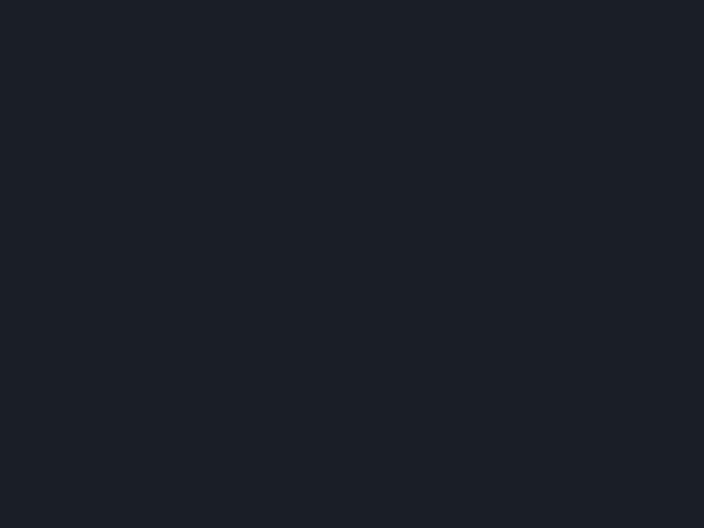

# suggar 表情包

棕色双马尾猫娘 **NekoGirl** 动态表情包，收录 **211** 个 GIF 动画表情，按 15 个聊天语义类别整理，适配 [AstrBot Meme Manager](https://github.com/)。



## 内容

基于 [EmoteLab](https://store.steampowered.com/app/4301100/EmoteLab/)（Steam）内置模型 **CoffeeBean** 自制形象导出，240×240 透明背景 GIF。

| 类别 | 数量 | 说明 |
|---|---|---|
| greeting 打招呼 | 18 | 到达、冒泡、打招呼、扩音器、Raid、通知提醒 |
| reply 回应 | 17 | 说话、说教、点头、按按钮、静音、Popcat |
| happy 开心 | 11 | 庆祝、得分、点赞、期待、胜利 |
| angry 生气 | 13 | 生气、撬棍、枪、刀、烧、敲头 |
| sad 委屈 | 10 | 哭、坐牢、被击中、死亡 |
| confused 发呆 | 12 | 呆住、问号、思考、头晕 |
| surprised 惊讶 | 8 | 惊吓、害怕、紧张、冒汗 |
| shy 害羞 | 9 | 害羞、吐舌、眨眼 |
| sleep 困倦 | 7 | 睡觉、小睡、加载打盹 |
| affection 亲近 | 16 | 爱心、玫瑰、情书、摸头、捏脸 |
| food 吃喝 | 19 | 吃零食、舔冰淇淋、喝饮料、蛋糕 |
| money 金钱 | 6 | 刷卡、红包、要米 |
| work 工作 | 16 | 打字、记录、Bug、带薪拉屎 |
| entertainment 玩乐 | 27 | 跳舞、唱歌、吉他、游戏、驾驶、魔法 |
| teasing 调侃 | 22 | 小丑、墨镜装酷、垃圾桶、一切都好(反讽) |

完整清单与每个表情的来源、帧数、时长、SHA256 见 [`source_index.json`](source_index.json)。

## 目录结构

```
├── manifest.json        # Meme Manager 包描述文件
├── memes_data.json      # 类别说明
├── memes/<类别>/        # 211 个 GIF（四位序号_动画名）
├── previews/            # 封面与概览图
└── source_index.json    # 来源索引
```

## 安装（AstrBot Meme Manager）

在 Meme Manager 的插件仓库列表中添加本仓库：

```
ze-tros/suggar-meme-pack
```

或手动下载后按 Meme Manager 文档导入。

## 制作信息

- 形象：NekoGirl（棕色双马尾猫娘、绿瞳、白色水手服+薄荷绿裙、白色贝雷帽）
- 制作工具：[EmoteLab](https://store.steampowered.com/app/4301100/EmoteLab/)（Spine 动态立绘，含皮肤、染色与自定义贴图编辑）
- 导出：211 个动画，240×240 GIF

## License

[MIT](LICENSE) © ze-tros；表情素材基于 EmoteLab 内置模型自制，模型的最终权利归 EmoteLab 开发者所有。
